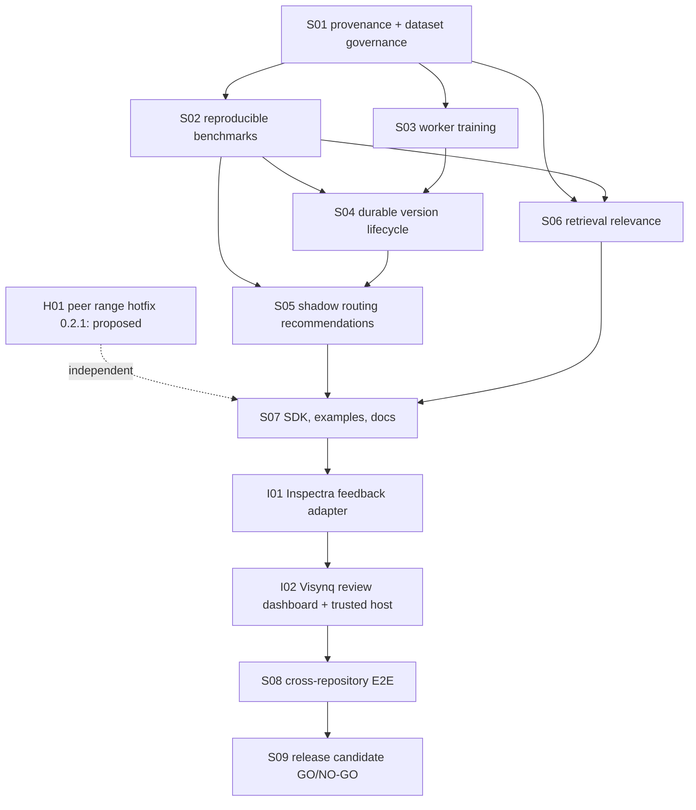

# SARASWATI S00 — Three-repository compatibility audit

| Field | Value |
| --- | --- |
| Project | ShivAX AI |
| Target line | 0.3.x SARASWATI |
| Current line | 0.2.0 NARASIMHA (`package.json`, `VERSION` in `src/index.ts`) |
| Phase | S00 — three-repository compatibility audit (`SHIVAX_v0.3_SARASWATI_Roadmap.md`) |
| Date | 2026-11-08 (revised the same day against the roadmap S00 checklist) |
| ShivAX branch / HEAD | `feat/saraswati-v0.3.0` at `776820f`, the same commit as `main` and `origin/main`. No git tags. **This is the `gitHead` of the published `shivax@0.2.0`** |
| Inspectra | `D:\Project\packages\inspectra`, `inspectra-engine` 1.1.0, `main` at `c57e172` (the `gitHead` of the published 1.1.0), clean, read only |
| Visynq | `D:\Project\packages\visynq-workstation`, `main` at `62f02e1`, 21 staged uncommitted files (firewall UI), read only |
| Visynq (legacy copy) | `D:\Project\packages\VISYNQ`, a git repository with no commits that depends on `inspectra-engine ^1.0.1`. Not used further |

Scope: S00 read the source and ran the tests. It changed no production code.
Inspectra and Visynq were not modified; their git state was hashed before and
after every run (§0.2). Nothing was published or tagged.

Separate from S00, one change was made at the user's request: the
**Vishwakarm → Vishwakarma rename** in ShivAX (uncommitted). It is recorded in
`CHANGELOG.md` `[Unreleased]` and in decision D2 (§8).

## Roadmap S00 checklist

| Roadmap requirement | Where answered |
| --- | --- |
| SHIVAX `package.json`, `src/learning/*`, `ekalavy.ts`, `memory/`, `security/firewall/`, `intelligence/`, `docs/learning-evaluation.md` | §1 |
| Inspectra `package.json`, `node/index.mjs`, `tests/integration/` | §1.2, §0.2 |
| Visynq `package.json`, `FirewallPage.tsx`, `firewall-client.ts`, `src/live/`, README | §1.2, §1.3, §7.1 |
| Which parts of learning, evaluation, rollback, memory and firewall already exist | §1 |
| Where learning datasets or labels could enter the scanner and the workstation | §1.3 |
| Check that Inspectra's `^0.1.2` excludes 0.2 and 0.3, and propose a *tested* update | §0.3, §7.1 |
| Visynq's invalid `.0.0` version and its missing production firewall host binding | §7.1, risk P1-4 |
| Repo-specific checks | §0.1, §0.2 |
| `npm view` registry state | §0.3 |
| Three-repository API map, test baseline, P0/P1 risks, safe delivery order | §1.2, §0, §7.2, §5 |

---

## 0. Baseline results

Environment: Windows 11 Pro, Node v22.23.2, pnpm 12.8.1, npm (bundled).

### 0.1 ShivAX (`D:\Project\packages\shivax`)

| Command | Before rename | After the Vishwakarma rename |
| --- | --- | --- |
| `pnpm lint` | exit 0 | exit 0 |
| `pnpm test` (includes build) | **792/792 pass**, 0 fail, cancelled or skipped. No build warnings | **793/793 pass** (+1 deprecated-alias test) |
| `pnpm verify:package` | exit 0. 12 entries in 5 declaration modes, 452 packaged files | exit 0, same counts |
| `INSPECTRA_ROOT=../inspectra node scripts/check-inspectra-package.mjs` | **exit 1**: `Only Inspectra 1.0.4 is certified by this check. actual: '1.1.0'` | Not rerun (the cause is in the script) |

### 0.2 Inspectra and Visynq (read only, tracked state hashed before and after)

| Repository | Command | Result | Tracked state after |
| --- | --- | --- | --- |
| Inspectra | `npm run build` (`scripts/check-build.mjs`: syntax check and entry-point import) | exit 0, "Package entry points verified" | unchanged |
| Inspectra | `npm run test:unit` | **10/10 pass** | unchanged |
| Inspectra | `npm run test:security` (network policy, network guard, **ShivAX adapter integration**, dev server; uses Chromium) | **31/31 pass** | unchanged |
| Visynq | `pnpm test` (`vitest run`) | **27 files, 243/243 tests pass**. These run against the sibling `../shivax/dist`, so they include the rename | `status`, staged diff and unstaged diff hashes identical |

Not run, and why:

- Inspectra `test:integration`, `test:ui-check` and `test:extraction`: these
  are long Playwright suites. The security suite already covers the ShivAX
  adapter. Run them in S08.
- Visynq `build` and `test:integration`: `tsc -b` rewrites the **tracked**
  `tsconfig.tsbuildinfo`, which is part of the staged work.

### 0.3 npm registry (checked 2026-11-08 with `npm view`)

| Package | Published versions | `latest` | Notes |
| --- | --- | --- | --- |
| `shivax` | 0.0.0-stage, 0.1.0, 0.1.2, 0.1.3, **0.2.0 (2026-11-07T16:22Z)** | 0.2.0 | Published `peerDependencies: { "inspectra-engine": "1.0.4" }`. `gitHead 776820f`. 453 files |
| `inspectra-engine` | 0.0.0-stage, 1.0.0–1.0.4, **1.1.0 (2026-11-07T18:41Z)** | 1.1.0 | 1.1.0 has `dependencies.shivax: "^0.2.0"`. 1.0.4 has `"^0.1.2"` |

**ShivAX docs are stale:** `CHANGELOG.md` ("not on npm yet"), the
`docs/release-readiness.md` header, and §6 of the first S00 draft all say
0.2.0 is unpublished.

**Real install test** in an empty scratch project:
`npm install --dry-run shivax@0.2.0 inspectra-engine@1.1.0` gives
**`ERESOLVE could not resolve … peerOptional inspectra-engine@"1.0.4" from shivax@0.2.0 … Found: inspectra-engine@1.1.0`** (exit 1).
Both packages are the current `latest`, so a new user installing both gets this
error today (risk P0-1).

**Range checks** with `semver@7.8.6` (`satisfies`):

| Range | 0.2.0 | 0.3.0 | 0.3.0-beta.1 | 0.4.0 |
| --- | --- | --- | --- | --- |
| `^0.1.2` | false | false | — | — |
| `^0.2.0` | true | **false** | — | — |
| `>=0.2.0 <0.4.0` (proposed for Inspectra, after S07) | true | true | **false** | false |

| Peer range | 1.0.3 | 1.0.4 | 1.1.0 | 2.0.0 |
| --- | --- | --- | --- | --- |
| `1.0.4` (current) | — | true | **false** | — |
| `^1.0.4` (proposed) | false | true | true | false |

---

## 1. Current implementation matrix

Legend: **Yes** = implemented and tested. **Partial** = exists, with a limit
that matters for SARASWATI. **No** = absent.

| Capability | Status | Where | Actual behaviour and limits |
| --- | --- | --- | --- |
| Feedback validation | **Yes** | `src/learning/index.ts` `validateFeedback`, `learningFeedbackSchema` | Closed v1 record: `id`, `taskId`, `botId`, `domain` (6 domains), `input`, `output`, `decision` accept/reject/correct. `correction` is required exactly when the decision is `correct`. Limit 64 KiB. `snapshotValue` limits depth to 32 and node count to 10,000. **No timestamp, actor, source, tenant, consent or evidence fields** |
| Verified feedback storage | **Partial** | `storeLearningFeedback`; Ekalavy `learning.feedback`; `src/memory/services.ts`; `src/memory/validation.ts` `approval()` | Saved through the protected `shivax.memory.records.save` tool as `verified-outcome` with tag `learning-feedback`. Needs the host `verifyOutcome` predicate, a Vijay policy and approval. **Limits:** the namespace includes `sessionId`; the default TTL is 7 days (90 at most); 128 records and 1 MiB per namespace by default. Not a durable system of record |
| Legacy feedback path | **Yes** (compat) | Ekalavy `learning.record`/`learning.summarize`; `SessionFeedbackStore`; `shivax.feedback.append` | A separate, session-only append store |
| Privacy admission | **Yes** (memory only) | `privacy()` in `src/memory/validation.ts` | Rejects bearer tokens, private keys, `sk-`/AKIA keys, JWTs, `password=` and similar, email addresses, SSN patterns, and keys named password, token, cookie, email, phone, address and similar. A conservative filter, not a full DLP classifier |
| Evaluation datasets | **Yes** | `validateEvaluationDataset`, `evaluateDataset`, `validateEvaluationRecord` | 1–256 cases, 6 domains, run one after another, 30 s default timeout (300 s max), cancellation. Metrics: completion, exact-match accuracy, routing accuracy, invalid output rate, FP/FN, security pass rate, usage. Imported reports **never authorize** activation. Fixture: `tests/fixtures/learning-cases.mjs` (12 cases) |
| Benchmark repeatability | **Partial** | same | No dataset hash, seed, version or runtime fingerprint; one latency sample per case |
| Curated training export | **Yes** | `exportTrainingData`, `validateTrainingExport` | The host `approve` must return literal `true` for each record. Rejected feedback is excluded. Output `shivax-curated-training` v1 with `trust:'untrusted'`, 256 rows at most. **No provenance, deduplication or partitioning** |
| Offline model training | **Yes** (synchronous) | `trainOfflineCandidate`, `trainCuratedCandidate` | Trains a clone, at most 4096 rows. Training and held-out sets must not share ids or inputs. **Blocks the event loop** |
| Non-blocking training | **No** in the library; example only | `examples/digits/worker.mjs` | |
| Model version management | **Partial** | `EvaluatedModelUpdates` | Strict gate: candidate accuracy, completion and validity must all be 1. Keeps 16 versions in memory. Not durable |
| Approval and rollback | **Partial** | same | Approval must be literal `true`. One-step rollback, lost on restart. Pattern to reuse: firewall management lease, compare-and-swap and journal |
| Memory retrieval | **Yes** | `MemoryEngine.search/list`, `MemoryTaskLifecycle.recall` | Lexical term-fraction scoring or semantic cosine. Results are always untrusted |
| Retrieval relevance evaluation | **No** | — | |
| RUDRA routing | **Yes** (deterministic) | `orchestrator.ts`, `planner.ts` | Host allowlist, then the first bot by sorted id. The planner cannot choose bots |
| Model routing | **Yes** (deterministic) | `ModelRouter` | Ordered by locality, then id. Optional `providerId`. Remote needs `allowRemote`. Exact cost math; usage checks fail closed |
| Learning-assisted routing | **No** | — | |
| Firewall protections | **Yes** | `src/security/firewall/*`, Jay, Vijay | Enforce, monitor and lockdown modes. Deny by default. Shared budget, policy versions and rollback, audit log |
| NeuralNet / Tensor | **Yes** | `src/nn/NeuralNet.ts`, `src/core/Tensor.ts` | `SerializedNeuralNet` v1 is an inference snapshot (no optimizer moments or PRNG progress). Repeated `train()` calls reset the shuffle order |

### 1.1 Components to preserve

| Bot id | Class | Role |
| --- | --- | --- |
| `sanjay` | `SanjayBot` | Vision |
| `brihaspati` | `BrihaspatiBot` | Reasoning |
| `vishwakarma` | `VishwakarmaBot` | Code. Was `vishwakarm`; deprecated alias `VishwakarmBot` (see D2) |
| `chitragupt` | `ChitraguptBot` | Memory |
| `narad` | `NaradBot` | Messaging and routing support |
| `yudhishthir` | `YudhishthirBot` | Review |
| `ekalavy` | `EkalavyBot` | Learning: `learning.feedback`, `learning.record`, `learning.summarize` |

Also preserved: RUDRA (`RudraOrchestrator`, `CapabilityPlanner`), Jay, Vijay,
and the firewall.

### 1.2 Three-repository API map

| Consumer | Imports from ShivAX | Resolution today | Present in current `dist` |
| --- | --- | --- | --- |
| Inspectra `node/index.mjs`, `job-manager.mjs`, `analysis-worker.mjs` | `analyzeUI`, `validateUIAnalysisOptions` (`shivax`); types `UISnapshot`, `UIAnalysisOptions` | `pnpm` override `shivax: file:../shivax`, an injected copy dated 2026-11-07 21:50. `analyzeUI` output is byte-identical to the current `dist` on the `paired()` fixture | Yes |
| Inspectra `node/shivax.mjs` (`inspectra-engine/shivax`) | `InspectraInspectionProvider` (`shivax/adapters/inspectra`, loaded lazily); types `InspectionCaptureRequest`, `InspectionProviderContext`, `InspectraPageLease`, `InspectraPageSecurity` | same | Yes |
| Inspectra tests (`integration/*`, `extraction`, `ui-check`) | `analyzeUI`, `validateUISnapshot`, `normalizeUISnapshot`, `validateInspectionObservation`, `analyzeUIWithSLM`, `SLMClient`; `tests/integration/runner.mjs` reads `../../../shivax/tests/fixtures/ui-analysis.mjs` | same, plus a sibling path | Yes |
| ShivAX adapter, calling Inspectra | `captureUIPage` from `inspectra-engine/node` | Optional peer, exactly `1.0.4` | 1.1.0 still exports it |
| Visynq `src/lib/shivax-demo.ts` | `createSpecialistSystem` (`shivax/bots`), `Jay`, `PermissionPolicyRegistry` (`shivax/security`), `InspectionPlanner`, `INSPECTION_WORKFLOW_CAPABILITIES`, `validateInspectionObservation` (`shivax/integrations`), types from `shivax/rudra` | Not a dependency. `vite.config.ts` aliases and `tsconfig.json` paths point to `../shivax/dist/sdk/*`. **The README says the published package is used and sibling checkouts are not required, which contradicts the aliases** | Yes |
| Visynq `src/lib/firewall.ts`, `services/firewall-client.ts` | `FirewallError`; types `FirewallManagement`, `FirewallPolicy`, `FirewallPolicyProfile`, `FirewallAuditEvent`, `FirewallErrorCode`, `FirewallMode` (`shivax/security`) | same | Yes |
| Visynq diagnostics | `toSDKDiagnostic` (`shivax/diagnostics`) | same | Yes |
| Visynq, consuming Inspectra | `inspectra-engine ^1.0.4` (client and runner); `src/live/geometry.ts` imports types from `inspectra/client` | Local runner `scripts/local-runner.mjs` | — |

ShivAX itself references neither Visynq nor Playwright in `src/`, `package.json`
or packaged `adapters/` files. The only Playwright users are the dev scripts
`adapters/inspectra/test-live.mjs` and `refresh-fixtures.mjs`, which are not in
the package `files` list.

### 1.3 Where learning datasets or labels could enter

| Entry point | Repository | What exists today | Trust status | SARASWATI handling |
| --- | --- | --- | --- | --- |
| E1 Ekalavy `learning.feedback` | ShivAX | v1 `FeedbackRecord` saved as `verified-outcome` after host `verifyOutcome`, Vijay policy and approval | Host-verified, stored `untrusted`, session-scoped, expires | S01: governed feedback with provenance and host attestation; curation from those records |
| E2 Ekalavy `learning.record` | ShivAX | Free-form `{kind, data, score}` into `SessionFeedbackStore` | Unverified | **Never** a training source |
| E3 `exportTrainingData` import | ShivAX | Host-selected v1 rows; `validateTrainingExport` accepts any well-formed export | Untrusted | S01: partition and leakage checks also accept old v1 exports; no migration needed |
| E4 Inspectra local UI server `/api/reviews` (`server.js`) | Inspectra | Per-finding `{status: 'issue'/'accepted'/'ignored', note (2000 chars max), type, at}` keyed by `referenceUrl -> targetUrl` and a `fingerprint` matching `^[a-z0-9]{1,32}$`. Persisted to `visual-reports/reviews.json` (gitignored; `UI_REVIEWS_FILE` overrides). Host header, origin and JSON content type checked (1.1.0). **No reviewer identity and no scope or tenant** | Local, unauthenticated reviewer | I01: may only produce *proposed* feedback. A trusted ShivAX host must attest it |
| E5 Visynq `reviewExport()` (`src/live/geometry.ts`) | Visynq | Download block `visynqReview {version:1, scope, sessionId, exportedAt, decisions:[{issueId, status: unreviewed/confirmed/dismissed, notes}]}` attached to the Inspectra report | Created in the browser; no reviewer identity | I02: pending proposals only; the browser cannot mark them verified |
| E6 Inspectra scan output (findings, measurements) | Inspectra | Measured, design and inferred provenance on findings | Model or tool output | Evidence references only. Never labels on their own |

---

## 2. Missing functionality, mapped to roadmap phases

| # | Gap | Roadmap phase |
| --- | --- | --- |
| G1 | Feedback provenance: source, tenant owner, task, agent and model version, reviewer, evidence, consent purpose, label revision, redaction | **S01** |
| G2 | Content digests (no SHA-256 code exists in `src/`) | **S01** (dataset manifest), S02, S04 |
| G3 | Curated dataset manifest, deduplication and leakage-safe train/validation/held-out partitions | **S01** |
| G4 | Training eligibility that untrusted output cannot assert for itself | **S01** |
| G5 | Repeatable benchmarks: seed, dataset hash, fingerprint, latency distribution, regression thresholds, mandatory 100% security-denial cases | S02 |
| G6 | Non-blocking (worker) training | S03 |
| G7 | Chunked or resumed training is not bit-identical to a single run | S03 (document the tolerance) |
| G8 | Durable model and configuration registry with compare-and-swap activation and restart-safe rollback | S04 |
| G9 | Approved model version to `NeuralModelProvider`; firewall model operations hold a fixed provider | S04 |
| G10 | Learning-assisted routing (shadow first) | S05 |
| G11 | Retrieval relevance evaluation (precision@k, MRR) | S06 |
| G12 | Optional peer pin `inspectra-engine: 1.0.4` | **H01** (proposed hotfix, §5) |
| G13 | Stale "0.2.0 not published" statements in ShivAX docs | H01 or S07 |

---

## 3. Proposed v0.3 architecture

### 3.1 Principles

1. **Additive only.** New modules go in `src/learning/`. `index.ts`,
   `training.ts` and `updates.ts` keep their exports, signatures and gates.
2. **Platform-neutral core.** No eager Node built-in imports in the
   browser-safe bundles. A Node `worker_threads` executor ships behind a
   separate documented entry point (roadmap S03).
3. **Integrity is not authenticity.** A digest shows the content is unchanged.
   Reviewer identity and verification come only from trusted host callbacks,
   checked again when a dataset is curated. All learning data stays
   `trust:'untrusted'`.
4. **Untrusted data cannot verify itself.** Provenance from feedback, models or
   Inspectra is a set of *claims*. The schema has no `verified`, `approved` or
   `reviewer` field. Attestations are a separate host-created record, bound to
   the content digest.
5. **Nothing activates itself.** No API chains train, gate and activate. Every
   activation needs approval to be literal `true`, plus the firewall and Vijay.
6. **Validate on load.** Stored artifacts are checked against their schema and
   digest every time they are read.

### 3.2 Components by phase

| Phase | Module | Purpose |
| --- | --- | --- |
| S01 | `src/learning/provenance.ts` | `FeedbackProvenance` v1 claims, `GovernedFeedback` v1 (wraps an unchanged v1 `FeedbackRecord`), `ReviewAttestation` v1, canonical JSON, SHA-256 digest, `storeGovernedFeedback` (same Chitragupt and Vijay path) |
| S01 | `src/learning/datasets.ts` | `curateDataset`: eligibility, tenant, consent, attestation, staleness and retention checks; deterministic deduplication; leakage-safe partition. `checkPartitionLeakage`, which also works on old v1 exports. `DatasetManifest` v1 |
| S02 | `src/learning/benchmarks.ts` | Versioned suites and reports, before-and-after comparison, thresholds, mandatory security cases |
| S03 | `src/learning/jobs.ts` plus a Node entry point | Training jobs, progress, cancellation, worker executor |
| S04 | `src/learning/registry.ts` | Durable registry with statuses `candidate`, `evaluated`, `approved`, `active`, `rejected`, `rolled_back` |
| S05 | `src/learning/routing.ts` | Shadow recommendation engine; deterministic routing stays authoritative |
| S06 | `src/learning/retrieval.ts` | Relevance metrics over labelled fixtures |

### 3.3 Dependency graph

Module dependencies inside ShivAX:

- `provenance.ts` uses `agents/validation` (`snapshotValue`, `record`,
  `identifier`), `memory/validation` (`privacy`) and `learning/index`
  (`validateFeedback`).
- `datasets.ts` uses `provenance.ts`, plus `training.ts`
  (`validateTrainingExport`) for v1 compatibility.
- `benchmarks.ts` uses `evaluateDataset` and the `provenance` digests.
- `jobs.ts` uses `training.ts` and `nn/NeuralNet`.
- `registry.ts` uses the `benchmarks`, `jobs` and `provenance` digests, and
  `intelligence/neural`.
- `routing.ts` uses `benchmarks` and `registry`, reads `ModelRouter` and RUDRA
  only in shadow mode, and is never on the execution path by default.

---

## 4. Files requiring changes

| File | Phase | Change |
| --- | --- | --- |
| `src/learning/provenance.ts`, `src/learning/datasets.ts` (new) | S01 | New |
| `tests/learning-governance.test.mjs`, `tests/fixtures/governed-feedback.mjs` (new) | S01 | New |
| `src/sdk/learning.ts`, `src/index.ts` | S01–S06 | Additive `export *` |
| `docs/learning-governance.md` (new), `docs/learning-evaluation.md`, `CHANGELOG.md` | S01 and later | Docs |
| `src/learning/benchmarks.ts`, `jobs.ts`, `registry.ts`, `routing.ts`, `retrieval.ts` (new) | S02–S06 | New |
| `package.json` | H01 / S09 | Peer range `^1.0.4` (H01). Version `0.3.0` only at S09 with authorization |
| `scripts/check-inspectra-package.mjs`, `adapters/inspectra/index.mjs` (message text), `tests/inspectra-adapter.test.mjs` | H01 | Certify 1.1.0 |
| `docs/release-readiness.md`, `CHANGELOG.md` 0.2.0 header | H01 / S07 | Correct the "not published" statements |
| Inspectra (`package.json`, adapter) | I01 | Out of ShivAX scope |
| Visynq (`package.json` version, review UI, trusted host) | I02 | Out of ShivAX scope |

**Must not change in SARASWATI core:**

- `src/learning/index.ts`, `training.ts`, `updates.ts`
- `src/bots/*`, except the completed rename (D2)
- `src/security/jay.ts`, `vijay.ts`, `firewall/*`
- `src/nn/*`, `src/core/Tensor.ts`
- `src/memory/*`

---

## 5. Safe delivery order

| Order | Phase | Repository | Gate (from roadmap) |
| --- | --- | --- | --- |
| 0 | **H01 (proposed, needs authorization):** 0.2.1 hotfix from `main` to widen the peer range to `^1.0.4`, certify 1.1.0 and correct the stale publish statements | ShivAX | Real `npm install` of `shivax` and `inspectra-engine@1.1.0` resolves; 0.2.0 tests unchanged |
| 1 | S01 provenance and dataset governance | ShivAX | Unauthorized or unverified content never becomes training data; v1 learning tests pass |
| 2 | S02 reproducible benchmarks | ShivAX | Two identical runs give the same logical results; corrupt reports fail |
| 3 | S03 worker training | ShivAX | Synchronous behaviour unchanged; the event loop is not blocked |
| 4 | S04 durable version lifecycle | ShivAX | Rejected or failed candidates cannot activate; rollback survives a restart |
| 5 | S05 shadow routing | ShivAX | Default routing is byte-for-byte compatible |
| 6 | S06 retrieval relevance | ShivAX | No cross-scope leakage; gains measured on fixtures |
| 7 | S07 SDK, examples, docs | ShivAX | A fresh tarball consumer runs every example |
| 8 | I01 Inspectra adapter | Inspectra | Old report consumers keep working |
| 9 | I02 Visynq dashboard and trusted host | Visynq | Review actions only create pending proposals |
| 10 | S08 cross-repository E2E | all | One offline approval flow passes |
| 11 | S09 release GO/NO-GO | ShivAX first | All P0 items pass; no automatic publishing |

Each phase ends with `pnpm lint`, `pnpm test`, `pnpm verify:package` and its own
`docs/audits/saraswati-sNN.md`. Each phase stops for review.

---

## 6. Acceptance tests

### 6.1 Every phase

1. All existing tests pass (floor: 793 after the rename).
2. Lint and `verify:package` exit 0. ESM and CJS export name sets are equal.
3. The seven bot ids and capabilities are unchanged, apart from D2.
4. No file under `src/security/firewall/` changes.
5. No Playwright dependency in `package.json` and no Playwright import in `dist/`.
6. No exported API both produces and activates a candidate.

### 6.2 S01 (the next phase)

| # | Test |
| --- | --- |
| A1 | Existing v1 `validateFeedback`, `exportTrainingData`, `validateTrainingExport` and `trainCuratedCandidate` behaviour unchanged (existing 17 learning tests) |
| A2 | Malicious feedback: provenance carrying `verified`, `approved`, `reviewer`, `__proto__` or unknown keys is rejected; secrets, emails and tokens anywhere in the record are rejected |
| A3 | Unverified: a record without a matching host attestation is excluded, as is one whose attestation digest no longer matches after an edit |
| A4 | Untrusted sources (`model-output`, `inspection-finding`) are excluded unless a human-review attestation exists, and they can never attest themselves |
| A5 | Cross-tenant: a record whose owner scope differs from the curation scope is excluded |
| A6 | Consent withdrawn: host `consentActive` returning anything except literal `true` excludes the record; a missing purpose excludes it |
| A7 | Stale reviewer: an attestation older than `maxAttestationAgeMs`, or host `reviewerActive` returning anything except `true`, excludes it |
| A8 | Duplicates: an identical duplicate collapses to one row; same id with different content excludes both; conflicting labels on the same input exclude all; a superseded label revision is replaced |
| A9 | Oversized: feedback above 64 KiB, provenance above its limit, depth above 32, or too many records or evidence items is rejected |
| A10 | Partition: no feedback id, canonical input or source group appears in two splits; the same seed gives the same split; a different seed is still leak-free |
| A11 | `checkPartitionLeakage` detects id and input leaks in old v1 exports |
| A12 | The split outputs are valid v1 exports that `trainCuratedCandidate` accepts |
| A13 | `storeGovernedFeedback` persists only through `shivax.memory.records.save` with host verification, Vijay policy and approval; a denial leaves memory unchanged |
| A14 | Exclusion reports contain only ids and reason codes, never content |
| A15 | The manifest digest is the same regardless of input order and key order, and changes when any row changes |

Later phases: the roadmap gates in §5, refined in each phase's audit.

---

## 7. Compatibility and security risks

### 7.1 Interoperability findings

- **Inspectra's ShivAX range.** `^0.1.2` belongs to Inspectra 1.0.4 (commit
  `7ba4d70`, published). The current 1.1.0 (`48b8d31`, published) declares
  `^0.2.0`. Neither range accepts 0.3.0 (§0.3). Proposed tested update for
  I01, after S07: `>=0.2.0 <0.4.0`, or `^0.3.0` if 0.3 changes anything
  Inspectra uses. Prereleases need an explicit range.
- **Adapter security contract.** The page security contract is structural
  (`checkDestination`, `owner`, `timeoutMs`, `context.checkNetworkAccess`).
  It does not use module-private WeakMaps, and providers are checked by shape.
  A nested 0.2 adapter inside a 0.3 host therefore still enforces the host
  firewall.
- **Visynq** is already optional: no package dependency in either direction.
  - `package.json` has version `".0.0"`, which is invalid SemVer (fix in I02).
  - **Missing production firewall host binding**, confirmed in source:
    `FirewallPage` renders `NotConnected` when `client` is `null`;
    `firewall-client.ts` states "R07 ships no production transport"; the
    README requires a trusted host to pass a binding to
    `<App firewall={…} />`; and the Inspectra runner token must not be used
    as that transport.
  - The README's "sibling checkouts are not required" contradicts the Vite
    and tsconfig aliases to `../shivax/dist`.

### 7.2 Risk register (P0 = blocks a safe release or harms current users; P1 = must be fixed in its phase)

| ID | Risk | Mitigation |
| --- | --- | --- |
| **P0-1** | The published `shivax@0.2.0` together with the published `inspectra-engine@1.1.0` fails to install (`ERESOLVE`) — reproduced | H01 hotfix 0.2.1 with `^1.0.4` (needs authorization to publish) |
| **P0-2** | Autonomous deployment: chaining train, benchmark and promote | No combined API. Approval must be literal `true`. Firewall state-changing capability. Static call-site test |
| **P0-3** | Unverified, model or Inspectra output becoming training data | S01: claims-only provenance, host attestation bound to the digest, eligibility checked again at curation |
| **P0-4** | Cross-tenant training data or embeddings | S01: owner scope must match the curation scope; S06: the same for retrieval |
| **P0-5** | Breaking 0.2 public APIs or relaxing the strict gate in `EvaluatedModelUpdates` | Do-not-change list; existing tests; ESM/CJS export parity |
| **P1-1** | Two ShivAX copies (0.3 app plus nested 0.2 under Inspectra). `toSDKDiagnostic` uses `instanceof` | Keep the inspection contracts frozen; widen Inspectra in I01 |
| **P1-2** | Bot id rename `vishwakarm` → `vishwakarma` (committed in `4d0a372`) breaks host policies that name the old id; they fail closed | D2 resolved as option A. A migration note is in CHANGELOG. Release notes for 0.3.0 (S07) must call it out |
| **P1-3** | Verified feedback expires within 7–90 days and is session-scoped | S01: curation copies rows into the manifest's split exports; durable dataset storage in S04 |
| **P1-4** | Visynq's firewall UI has no production transport; reviews are created in the browser without identity | I02: a trusted host adapter; the browser only proposes |
| **P1-5** | Inspectra `/api/reviews` has no reviewer identity or tenant | I01: proposals only |
| **P1-6** | Chunked or resumed training differs from a single run | S03: document the tolerance |
| **P1-7** | A forged or edited attestation or manifest in storage (a digest is not authenticity) | Host checks the reviewer again at curation; optional host signing hook (S04) |
| **P1-8** | Dataset poisoning through correct feedback | Curation, attestation and held-out non-regression (S02, S04) |
| **P1-9** | Docs say 0.2.0 is unpublished | H01 or S07 |
| P2-1 | Visynq README contradicts its sibling aliases | I02 |
| P2-2 | Cooperative training holds the thread for one chunk | S03: worker executor |

---

## 8. Decisions needed from the user

| ID | Decision | Recommendation |
| --- | --- | --- |
| D1 | Authorize the H01 hotfix branch (`fix/peer-range-0.2.1` from `main`) to fix P0-1. Publishing stays a separate decision | Yes. It affects current npm users and is independent of SARASWATI |
| D2 | The roadmap's universal rule says "keep exact bot IDs … `vishwakarm` …". The rename requested on 2026-11-08 changed the id to `vishwakarma`. **Resolved, option A:** the user committed the rename, including the id, as `4d0a372`. The current bot ids are `sanjay, brihaspati, vishwakarma, chitragupt, narad, yudhishthir, ekalavy`, and later phases must not change them. The breaking change against 0.2.0 is recorded in `CHANGELOG.md` | Update the roadmap's universal-instructions bot list to `vishwakarma` (the roadmap file is the user's; not edited) |

---

**S00 complete** (revised against the roadmap). S01 follows.
