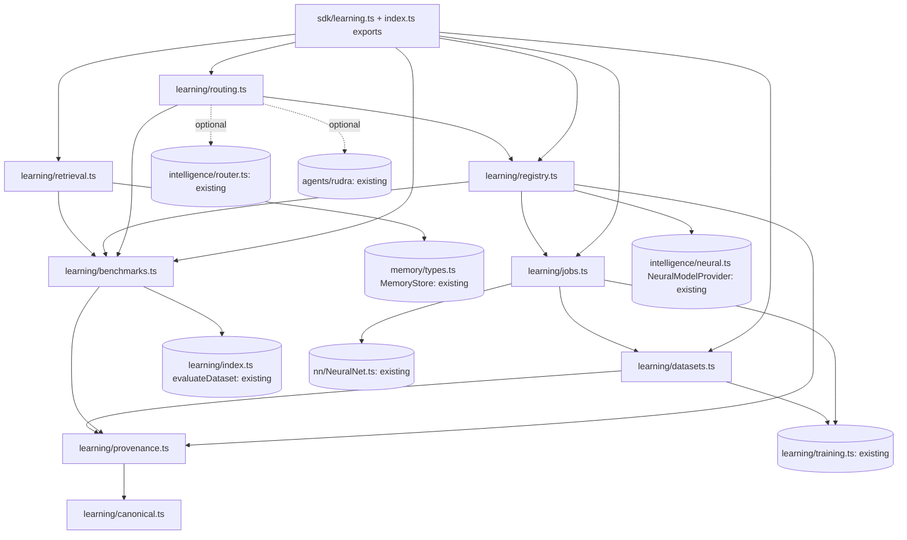

# SARASWATI S00 — Three-project baseline audit

| Field | Value |
| --- | --- |
| Project | ShivAX AI |
| Target line | 0.3.x SARASWATI |
| Current line | 0.2.0 NARASIMHA (`package.json`, `VERSION` in `src/index.ts`) |
| Phase | S00 — three-project baseline (audit only, no product code changed) |
| Date | 2026-11-08 |
| ShivAX branch / HEAD | `feat/saraswati-v0.3.0` at `776820f` (same commit as `main` and `origin/main`; no git tags exist) |
| Inspectra | `D:\Project\packages\inspectra`, `inspectra-engine` 1.1.0, `main` at `c57e172`, clean, read only |
| Visynq | `D:\Project\packages\visynq-workstation`, `main` at `62f02e1`, 21 staged uncommitted files, read only |
| Visynq (legacy copy) | `D:\Project\packages\VISYNQ`, git repository with no commits, `inspectra-engine ^1.0.1`, read only, not used further |

Scope: this phase read the source and ran the tests. It changed no product
code in any of the three repositories. Inspectra and Visynq were not modified.
Nothing was published or tagged. The only file added is this report.

---

## 0. Baseline results (Task 5)

All commands ran on Windows 11, Node v22.23.2, pnpm from `packageManager`
(`pnpm@12.8.1`), in `D:\Project\packages\shivax`.

| Command | Result |
| --- | --- |
| `pnpm lint` (`tsc --noEmit && eslint .`) | **exit 0**, no diagnostics |
| `pnpm test` (clean, `tsc`, CJS declarations, Rollup, then `node --test tests/*.test.mjs`) | **exit 0**. Build had no warnings. **792 tests, 792 pass, 0 fail, 0 cancelled, 0 skipped, 0 todo.** Total `duration_ms` 2102.6 |
| `pnpm verify:package` | **exit 0**. Packed ESM/CJS SDK imports pass. 7 documented examples present, 5 offline examples ran. Declarations pass for 12 entries in ts/bundler, mts/cts Node16 and mts/cts NodeNext modes. 452 packaged files |
| `INSPECTRA_ROOT=../inspectra node scripts/check-inspectra-package.mjs` | **exit 1** (expected; see §7.1): `AssertionError: Only Inspectra 1.0.4 is certified by this check. actual: '1.1.0', expected: '1.0.4'` |
| Read-only interop probe (scratchpad script; imports current `dist`, Inspectra's installed ShivAX copy, and `inspectra/node/index.mjs`) | All runtime symbols that Inspectra and Visynq import exist in the current 0.2.0 `dist` (§7.1). `analyzeUI` output from the current `dist` and from Inspectra's injected copy is byte-identical on the `paired()` fixture (6544 bytes). `inspectra-engine/node` exports `captureUIPage` as a function |

The 792-test total matches the 0.2.0 figure in `docs/release-readiness.md`.
This is the regression floor for every SARASWATI phase.

Inspectra and Visynq test suites were **not** run. Inspectra's suites launch
Playwright and write `test-results/`, `playwright-report/` and `debug.log` inside
that repository. Visynq has staged, uncommitted work in progress. Running either
would change a repository this phase must leave untouched. The compatibility
claims below rest on the interop probe and on ShivAX's own adapter tests.

---

## 1. Current implementation matrix (Task 1)

Legend: **Yes** = implemented and tested. **Partial** = exists, with a limit
that matters for SARASWATI. **No** = absent.

| Capability | Status | Where | Actual behaviour and limits |
| --- | --- | --- | --- |
| Feedback validation | **Yes** | `src/learning/index.ts` `validateFeedback`, `learningFeedbackSchema` | Closed v1 record: `id`, `taskId`, `botId`, `domain` (6 domains), `input`, `output`, `decision` accept/reject/correct. `correction` is required exactly when the decision is `correct`. Size cap 64 KiB. No timestamp, actor, source or consent fields |
| Verified feedback storage | **Partial** | `storeLearningFeedback`; Ekalavy `learning.feedback`; `src/memory/services.ts`; `src/memory/validation.ts` `approval()` | Saved through the protected tool `shivax.memory.records.save` as category `verified-outcome` with tag `learning-feedback`. Needs the host `verifyOutcome` predicate (otherwise `verification-required`) plus Vijay policy and approval. **Limits:** the namespace includes `sessionId` (`memoryNamespace()`), so feedback cannot be read from another session. Default TTL is 7 days (`DEFAULT_TTL['verified-outcome']`), configurable up to 90 days. Defaults allow 128 records (max 512) and 1 MiB per namespace. Memory is therefore **not a durable system of record** for training data |
| Legacy feedback path | **Yes** (compat) | Ekalavy `learning.record` / `learning.summarize`; `SessionFeedbackStore` (`src/bots/storage.ts`); `shivax.feedback.append` | A separate, session-only append store that is not connected to the learning module. Kept for compatibility |
| Evaluation datasets | **Yes** | `validateEvaluationDataset`, `evaluateDataset`, `validateEvaluationRecord` | 1–256 cases, unique ids, 6 domains. Cases run one after another with a 30 s default deadline (max 300 s), cancellation and evaluator isolation. Metrics: completion, exact-match accuracy (key-order independent), routing accuracy, invalid output rate, boolean FP/FN, security pass rate, model calls and tokens, `usageComplete`. Imported reports are checked for internal consistency and **never authorize activation**. Fixture: `tests/fixtures/learning-cases.mjs` (12 cases) |
| Benchmark repeatability | **Partial** | same | The `EvaluationRecord` embeds the dataset but has **no dataset digest, model digest, seed, ShivAX version, runtime fingerprint or repetition count**. Latency is a single sample per case |
| Curated training export | **Yes** | `exportTrainingData`, `validateTrainingExport` (`training.ts`) | The host's `approve` callback must return literal `true` for each record. Rejected feedback is excluded. Output is `{format:'shivax-curated-training', version:1, trust:'untrusted', rows}`, max 256 rows. **No provenance**: no source session, curator, time or content hash |
| Offline model training | **Yes** (synchronous) | `trainOfflineCandidate`, `trainCuratedCandidate`; `src/nn/NeuralNet.ts` | Clones the serialized model, trains the clone and never changes the active model. Rows must be numeric. Max 4096 rows. Training and held-out sets must not overlap (by id and by input), and labels must match the task. `weightsUpdated` compares real parameters. **It blocks the event loop.** `TrainOptions.signal` is only checked between epochs and batches, so it cannot interrupt a synchronous call. Held-out rows are returned to the caller, not evaluated |
| Non-blocking training | **No** (library). Example only | `examples/digits/worker.mjs` | The digit demo trains in a Web Worker. No reusable job runner, executor interface, progress events or job records exist in `src/` |
| Model version management | **Partial** | `EvaluatedModelUpdates` (`src/learning/updates.ts`) | Generic `{model, configuration}` snapshots. Runs baseline and candidate on the same dataset. The candidate must reach accuracy 1, invalid rate 0 and completion 1; the baseline result is reported but not used in the gate. Only one proposal can run at a time (`busy`). **History lives in memory (16 versions)**, with no identifiers, digests, persistence or link to datasets. Not connected to `ModelProviderRegistry` or `NeuralModelProvider` |
| Approval and rollback | **Partial** | `EvaluatedModelUpdates.propose/rollback` | Activating a version and rolling back both need the host approval callback to return literal `true`; both honour cancellation. Rollback only steps back one version and is lost when the process restarts. **Pattern to reuse:** `openShivaxFirewallManagement` (`src/security/firewall/management.ts`) already uses a durable lease, compare-and-swap commit, bounded history journal and validation on restore |
| Durable model version storage | **No** | — | No store interface or adapter. `MemoryEngine` cannot hold models: records are limited to 1 MiB and expire after at most 90 days |
| Memory retrieval | **Yes** | `MemoryEngine.search/list` (`src/memory/engine.ts`); `MemoryTaskLifecycle.recall` | Lexical mode scores the fraction of query terms found in the JSON of value, metadata and tags. Semantic mode uses cosine similarity with a host embeddings adapter (the provider id and dimension count must match). Results are filtered by category and tags, limited to 50 (default 20), and are always `trust:'untrusted'`. RUDRA recall takes at most 5 results, goes through Chitragupt and Vijay, and is passed to the planner as `memory.trust:'untrusted'` |
| Retrieval relevance evaluation | **No** | — | The `memory` evaluation domain only does exact-match checks. There is no precision@k, recall@k, MRR or nDCG, no relevance labels and no lexical-versus-semantic comparison |
| RUDRA routing | **Yes** (deterministic) | `src/agents/rudra/orchestrator.ts`, `planner.ts` | `CapabilityPlanner` makes a one-step plan. The plan is validated before any step runs. A capability must be in the host allowlist, and the bot chosen is the **first bot by sorted id** that offers it. The planner cannot name a bot or grant permissions. The trace records `decision: 'capability-then-bot-id'` |
| Model routing | **Yes** (deterministic) | `ModelRouter` (`src/intelligence/router.ts`) | Candidates come from the registry by capability and are sorted by locality (in-process, then local, then remote) and then by id. Optional `providerId` sets the preferred provider. Remote providers need `allowRemote:true`. Fallback is off unless enabled. Cost accounting is exact and token usage must be verifiable (fail closed). The firewall gateway route `createGuardedModelGateway` lists its operation ids in a fixed order |
| Learning-assisted routing | **No** | — | Neither router uses evaluation or benchmark history |
| Firewall protections | **Yes** | `src/security/firewall/*`, Jay, Vijay | Modes: enforce, monitor, lockdown. Deny by default. Operation kinds: cpu, tool, model, workflow, bot, file, network. One shared model budget, versioned policies with rollback, revocation, a sanitized audit log and protected execution binding. Not changed by this audit |
| NeuralNet / Tensor | **Yes** | `src/nn/NeuralNet.ts`, `src/core/Tensor.ts` | `SerializedNeuralNet` v1 holds an inference snapshot: optimizer moments and PRNG progress are deliberately left out. The training work limit is 250M operations per call |

### Specialist bots, orchestration and security components to preserve

The seven specialist bots, as `createSpecialistBots` builds them:

| Bot | Role |
| --- | --- |
| `SanjayBot` | Vision |
| `BrihaspatiBot` | Reasoning |
| `VishwakarmaBot` | Code |
| `ChitraguptBot` | Memory |
| `NaradBot` | Messaging and routing support |
| `YudhishthirBot` | Review |
| `EkalavyBot` | Learning. Capabilities: `learning.feedback`, `learning.record`, `learning.summarize` |

The orchestrator and security components:

- RUDRA: `RudraOrchestrator` and `CapabilityPlanner`.
- Jay: `src/security/jay.ts`.
- Vijay: `src/security/vijay.ts`.

None of these need changes for the core of SARASWATI (§4).

---

## 2. Missing functionality for SARASWATI (Task 2)

| # | Gap | Why it matters | Evidence |
| --- | --- | --- | --- |
| G1 | **Dataset provenance** | Feedback and training exports cannot prove their origin, who curated them or whether they changed after approval. Any benchmark or model version built on them inherits that uncertainty | `exportTrainingData` output has no source, actor, time or hash fields. The `FeedbackRecord` has no timestamp or actor |
| G2 | **Content digests** | A dataset, report or model cannot be referred to by an identity that cannot be forged. No SHA-256 or digest code exists anywhere in `src/` | `grep sha256/subtle/digest src` finds nothing |
| G3 | **Training dataset lifecycle** | There is no draft → frozen → approved → retired flow, and no durable store. Verified feedback lives in session-scoped memory that expires after 7 to 90 days, so a dataset must be copied out of memory when it is frozen | `memoryNamespace` includes `sessionId`; `DEFAULT_TTL` |
| G4 | **Deterministic splits** | `trainCuratedCandidate` needs separate training and held-out exports, but nothing produces a reproducible split | `training.ts` |
| G5 | **Repeatable benchmarks** | The evaluation record has no seed, dataset digest, model digest, version or runtime fingerprint, and only one latency sample. Two runs cannot be shown to be comparable, and regression thresholds cannot be set | `EvaluationRecord` |
| G6 | **Benchmark comparison gate** | `EvaluatedModelUpdates` requires 100% accuracy and ignores the baseline. Real models need "no regression beyond a threshold" against a pinned baseline. The current strict gate must stay as it is | `updates.ts` |
| G7 | **Non-blocking training** | Synchronous `NeuralNet.train` blocks the host. There is no job model with queued/running/terminal states, progress, cancellation or work budgets, and no worker executor in the library | `NeuralNet.train`, `TrainOptions.signal` comment |
| G8 | **Exact chunked training** | Calling `train({epochs:1})` N times on one instance keeps optimizer and PRNG state, but **resets the shuffle order to identity on each call**. Chunked training is therefore not bit-identical to `train({epochs:N})`. Resuming from `toJSON()` also loses optimizer moments. Determinism has to be defined per job, including its chunk schedule | `NeuralNet.train` (`order` is rebuilt each call); `toJSON` comment |
| G9 | **Durable model version storage** | Versions are not persistent, have no ids or digests and are not linked to their dataset or benchmark. Rollback does not survive a restart | `updates.ts` (in memory, 16 versions) |
| G10 | **Model-to-provider bridge** | Nothing turns an approved version into a `NeuralModelProvider`. Firewall model operations hold a fixed `provider` object, so a new model version needs new firewall operations. It cannot be swapped in place | `FirewallModelOperation.provider` |
| G11 | **Learning-assisted routing** | Both routers are purely deterministic and have no advisory input from measured quality, latency or cost | `ModelRouter` sort; RUDRA `bots.find` |
| G12 | **Retrieval relevance evaluation** | Lexical and semantic recall cannot be measured, and the two modes cannot be compared | `MemoryEngine.search` |
| G13 | **Optional peer range** | The exact `inspectra-engine: 1.0.4` peer conflicts with Inspectra 1.1.0 (§7.1) | `package.json` `peerDependencies` |

---

## 3. Proposed v0.3 architecture (Task 4)

### 3.1 Principles

1. **Additive only.** New modules go under `src/learning/`. `index.ts`, `training.ts`
   and `updates.ts` are not rewritten. Their exports, signatures and gates stay
   as they are. The new code calls them.
2. **Platform neutral.** No Node-only imports in core. Workers, file systems and
   stores are supplied by the host through interfaces, following the
   `MemoryPersistence`, `MemoryFileSystem` and `FirewallPolicyStore` patterns.
   No runtime dependencies, and no Playwright.
3. **Integrity is not trust.** Digests prove that content has not changed. They
   do not prove it is true. All learning data stays `trust:'untrusted'`.
4. **Nothing activates itself.** Training produces candidates. Benchmarks
   produce reports. Only an explicit `promote()` can activate a version, and
   only when an approval callback returns literal `true`. Under the firewall it
   must also pass a state-changing Vijay capability. No code path chains
   train → gate → activate.
5. **Advice cannot grant access.** Learning-assisted routing can only reorder
   candidates that are already allowed. It never adds a provider, bot, capability,
   locality or permission.
6. **Validate on load.** Every stored artifact is checked against its schema and
   its digest when read back, as firewall management does with `policy()` on
   restore.

### 3.2 Components

| Module (new) | Purpose | Key public surface (proposed) |
| --- | --- | --- |
| `src/learning/canonical.ts` | Canonical JSON and SHA-256 using Web Crypto (`crypto.subtle.digest`, available in Node 22+ and browsers) | `canonicalJSON(value)`, `digestJSON(value, signal): Promise<Digest>` with `Digest = 'sha256:<64 hex>'` |
| `src/learning/provenance.ts` | Dataset manifests and provenance | `DatasetManifest` v1: `id`, `version`, `contentDigest`, `rowCount`, `domains`, `sources[]` (`verified-feedback`, `curated-import`, `evaluation-fixture` or `synthetic`, each with feedback ids and an opaque `actorRef`), `parents[]` digests, `createdAt`, `consent` flags, `trust:'untrusted'`. `createDatasetManifest`, `validateDatasetManifest`, `verifyDatasetContent` |
| `src/learning/datasets.ts` | Dataset lifecycle and deterministic splits | States: `draft`, `frozen`, `approved`, `retired`. `freeze()` copies the rows into the store and fixes the digest. `approve()` needs the host callback to return `true`. `splitDataset(rows, {seed, ratios})` assigns each row by a seeded hash of its `feedbackId` and is checked for disjointness. `DatasetStore` interface: lease plus compare-and-swap commit. `InMemoryDatasetStore`. `FileDatasetStore` takes a host-supplied fs, in the style of `MemoryFileSystem` |
| `src/learning/benchmarks.ts` | Repeatable benchmarks | `BenchmarkSuite` v1: `id`, `datasetDigest`, `cases`, `repetitions`, `seed`. `runBenchmark(suite, subject, evaluate, signal)` wraps `evaluateDataset` once per repetition. `BenchmarkReport` v1 holds `suiteDigest`, `subjectDigest`, environment (ShivAX `VERSION`, runtime name and version), deterministic metrics (must be identical across repetitions or the run is flagged `nondeterministic`) and latency p50/p95/max. `compareBenchmarks(baseline, candidate, thresholds)` returns a verdict per metric. `validateBenchmarkReport` |
| `src/learning/retrieval.ts` | Retrieval relevance evaluation | `RetrievalCase` holds `query: MemoryQuery` and graded `relevant: {id, grade}[]`. `evaluateRetrieval(store, namespace, cases, {k}, signal)` reports precision@k, recall@k, MRR, nDCG@k and hit rate, per mode (lexical or semantic) and overall. It runs against a host-supplied `MemoryStore`, usually an isolated `MemoryEngine` filled from a fixture. Output follows the `BenchmarkReport` format |
| `src/learning/jobs.ts` | Training without blocking the host | `TrainingJobSpec` v1: model digest, dataset digest, split seed, `TrainOptions`, **chunk schedule**, budgets. `TrainingJobRunner` with states queued, running, then succeeded, failed or cancelled, plus progress events and a `signal`. `TrainingExecutor` interface. `CooperativeTrainingExecutor` runs epoch chunks and yields between them on the main thread. `createPortTrainingExecutor(factory)` works with any `postMessage` port (Web Worker or `worker_threads`) supplied by the host and cancels by terminating it. Output: a `TrainingArtifact` (serialized model, digest, losses, spec digest). **Never activates** |
| `src/learning/registry.ts` | Durable model versions | `ModelVersionRecord` v1: `versionId`, `modelDigest`, `datasetDigest`, `benchmarkDigest`, `parent`, state (`candidate`, `approved`, `active`, `retired` or `rolled-back`), opaque approval `actorRef`s. `ModelVersionRegistry` methods: `register(candidate)`, `promote(versionId, comparison, approve, signal)`, `rollback(approve, signal)`, `active()`, `history()`. `ModelVersionStore` interface (lease plus compare-and-swap, with the journal appended atomically). `InMemoryModelVersionStore`. `FileModelVersionStore` with a host fs. Helper `createNeuralProviderFromVersion(record, id)` returns a `NeuralModelProvider`; the host must still rebuild its firewall operations |
| `src/learning/routing.ts` | Learning-assisted routing advice | `RoutingAdvisor` builds advice from `BenchmarkReport`s that the host generated itself; imported reports are rejected. `adviseProviders(capability, allowedIds)` returns a reordered subset of `allowedIds`. `adviseBots(capability, candidateBotIds)` does the same for bots. Results are deterministic, with ties broken by id. Optional `ModelRoutingOptions.preference` (additive) or a host-side `providerId` selection |

### 3.3 Integration points with existing code

| Existing component | How SARASWATI uses it | Change type |
| --- | --- | --- |
| `exportTrainingData` / `validateTrainingExport` | Starting point for `draft` datasets. Its output is wrapped in a manifest | None |
| `trainCuratedCandidate` / `trainOfflineCandidate` | Called inside the job executors, so all existing validation still applies | None |
| `evaluateDataset` | Called once per benchmark repetition | None |
| `EvaluatedModelUpdates` | Stays as the strict in-memory gate. The registry is a parallel, durable option, and the docs explain when to use each | None |
| `NeuralNet.fromJSON/toJSON` | Model artifacts use the existing `SerializedNeuralNet` v1 | None |
| `MemoryEngine` / `MemoryStore` | Read when assembling datasets (verified outcomes) and by the retrieval evaluator. Never used to store models or frozen datasets | None |
| Firewall | Training jobs run as `kind:'cpu'` host operations. `promote` and `rollback` run as `state-changing` operations under a separate capability that needs human approval, as `adminCapability` does | None to the firewall. Host wiring documented |
| `ModelRouter` | S08 option A: the host passes the advisor's top id as `providerId` (no ShivAX change). Option B: an additive optional `preference` routing key | Optional additive |
| `RudraOrchestrator` | S08 option: an optional `RudraHooks.botAdvisor` that can only reorder the bots RUDRA already found for a capability. Today each capability maps to one bot, so this matters only for host-registered extra bots | Optional additive (see risk R7) |
| Ekalavy | No change until S09. Then possibly one read-only `learning.benchmark.summarize`. **Never** training, promotion or rollback capabilities on any bot | Deferred |

### 3.4 Implementation dependency graph

Module level (arrow means "depends on"):



Phase level (must finish before):

```text
S01 Compatibility guardrails
 └─► S02 Canonical digests + provenance
      ├─► S03 Dataset lifecycle + DatasetStore
      │    └─► S06 Non-blocking training jobs ─┐
      ├─► S04 Repeatable benchmarks ───────────┼─► S07 Durable model version registry
      │    └─► S05 Retrieval relevance eval    │        └─► S08 Learning-assisted routing
      │                                        │                 └─► S09 SDK/Ekalavy/docs integration
      └────────────────────────────────────────┘                          └─► S10 Hardening + release readiness (no publish)
```

S04 and S05 can run in parallel with S03 and S06 once S02 is done.

---

## 4. Files requiring changes

### 4.1 New files

| File | Phase |
| --- | --- |
| `tests/api-surface.test.mjs`, `tests/fixtures/api-surface-0.2.0.json` (runtime export names per entry point, generated from the current `dist`) | S01 |
| `src/learning/canonical.ts`, `src/learning/provenance.ts` | S02 |
| `src/learning/datasets.ts` (plus in-memory and file dataset stores) | S03 |
| `src/learning/benchmarks.ts` | S04 |
| `src/learning/retrieval.ts`, `tests/fixtures/retrieval-cases.mjs` | S05 |
| `src/learning/jobs.ts`, `examples/sdk/training-worker.mjs` (host-side worker example) | S06 |
| `src/learning/registry.ts` (plus in-memory and file model version stores) | S07 |
| `src/learning/routing.ts` | S08 |
| `tests/saraswati-provenance.test.mjs`, `-datasets`, `-benchmarks`, `-retrieval`, `-jobs`, `-registry`, `-routing` | S02–S08 |
| `docs/saraswati.md` (guide), `docs/audits/saraswati-sNN.md` (one per phase) | each phase |

### 4.2 Existing files, additive edits only

| File | Change | Phase |
| --- | --- | --- |
| `package.json` | Widen `peerDependencies.inspectra-engine` from `1.0.4` to `^1.0.4` (G13). Version bump to `0.3.0` **only in S10**. No new dependencies | S01, S10 |
| `scripts/check-inspectra-package.mjs` | Certify 1.1.0, or a list of certified versions, instead of asserting exactly `1.0.4` | S01 |
| `adapters/inspectra/index.mjs` | Update the setup message text "Install optional peer inspectra-engine@1.0.4". Behaviour unchanged | S01 |
| `tests/inspectra-adapter.test.mjs` | Match the updated message | S01 |
| `src/sdk/learning.ts` | `export *` from the new learning modules | S02–S08 |
| `src/index.ts` | The same root exports. `VERSION` set to `'0.3.0'` only in S10 | S02–S08, S10 |
| `scripts/check-sdk-package.mjs` | Only if new documented examples are added to `files` | S06, S09 |
| `src/intelligence/types.ts`, `src/intelligence/router.ts` | **Optional (S08 option B):** add `preference?: readonly string[]` to `ModelRoutingOptions` and its closed-key `record()` list | S08 |
| `src/agents/rudra/types.ts`, `orchestrator.ts` | **Optional:** `RudraHooks.botAdvisor` and a new trace `decision` value (risk R7) | S08 |
| `src/bots/ekalavy.ts` | **Optional:** one read-only summary capability. Existing three capabilities unchanged | S09 |
| `CHANGELOG.md` | Add `0.3.x SARASWATI` to the release table and an `[Unreleased]` section | each phase |
| `docs/learning-evaluation.md`, `docs/SHIVAX_PHASES.md`, `docs/sdk.md`, `README.md`, `docs/production.md`, `docs/release-readiness.md` | Documentation | S09, S10 |

### 4.3 Files that must not change in SARASWATI core

`src/learning/index.ts`, `src/learning/training.ts`, `src/learning/updates.ts`,
`src/bots/{sanjay,brihaspati,vishwakarma,chitragupt,narad,yudhishthir}.ts`,
`src/bots/system.ts`, `src/security/jay.ts`, `src/security/vijay.ts`,
`src/security/firewall/*`, `src/nn/*`, `src/core/Tensor.ts`, `src/memory/*`.
Any proposed change to these needs its own review and must say so in that
phase's audit.

No files in `D:\Project\packages\inspectra` or `D:\Project\packages\visynq-workstation`
change during S01–S10.

---

## 5. Ordered phases

| Phase | Goal | Depends on | Exit criteria |
| --- | --- | --- | --- |
| **S01** Compatibility guardrails | Freeze the 0.2 public surface and unblock Inspectra 1.1.0 | S00 | API surface test passes, with every current export still present. Peer range widened. Inspectra certification passes against the installed 1.1.0 (requires Chromium through Inspectra's Playwright; skipped if absent, with the reason stated). 792 + new tests pass |
| **S02** Digests and provenance | Content identity for data and artifacts | S01 | Canonical JSON is the same regardless of key order. SHA-256 matches known test vectors. Manifest validation is closed. Tampered content is rejected |
| **S03** Dataset lifecycle | Durable, reproducible training datasets | S02 | The state machine rejects illegal transitions. `freeze` copies the rows. Splits are deterministic and disjoint. Store compare-and-swap conflicts are detected. Data read back is checked against the schema and digest |
| **S04** Repeatable benchmarks | Comparable, versioned evaluation | S02 | The same suite and subject give identical deterministic metrics across repetitions and processes. Nondeterminism is flagged. `compareBenchmarks` thresholds are enforced. Reports cannot be forged into authorization |
| **S05** Retrieval relevance | Measure memory recall | S04 | Metric values match worked examples by hand. Lexical and semantic results are reported separately. Runs only against a host-supplied store |
| **S06** Non-blocking training | Jobs that keep the host responsive | S03 | Event-loop delay stays bounded during cooperative training. A port executor cancels by terminating. Same spec gives the same artifact digest. Work limits are enforced. No activation |
| **S07** Durable model versions | Persistent registry with approval and rollback | S04, S06 | Promotion needs the gate plus literal `true` approval. Rollback survives a simulated restart. The journal is append-only. A corrupt store fails closed. The provider bridge works |
| **S08** Learning-assisted routing | Advisory ordering from measured results | S04, S07 | Advice is a permutation of a subset of the allowed candidates. Remote, firewall and policy denials still apply. With no reports, behaviour is unchanged. Imported reports are rejected |
| **S09** Integration | SDK exports, examples, docs, optional Ekalavy read-only summary | S03–S08 | `verify:package` passes. Documented examples run offline. The seven bots and their capabilities are unchanged (or changed only additively) |
| **S10** Hardening and release readiness | Security review, attack tests, version decision | S09 | All acceptance tests pass. Release readiness report written. **No publish and no tag** |

Each phase ends with `pnpm lint`, `pnpm test` and `pnpm verify:package`, plus
its own `docs/audits/saraswati-sNN.md`. Each phase stops for review before the
next one starts.

---

## 6. Acceptance tests

### 6.1 Global regression (every phase)

1. `pnpm test`: the 792 baseline tests still pass, with 0 failures, cancellations or skips.
2. `pnpm lint` and `pnpm verify:package` exit 0.
3. **API surface:** for each of the 12 entry points, the runtime export names are
   a superset of `tests/fixtures/api-surface-0.2.0.json`, and ESM and CJS name sets
   are equal (extends the existing `tests/sdk.test.mjs` check).
4. **NeuralNet and Tensor:** a fixed-seed network trained on the existing XOR fixture
   gives the same `toJSON()` before and after each phase, and `Tensor` tests pass
   unchanged.
5. **Bots:** `createSpecialistBots()` returns the seven bots in the same order, with
   the same ids and capability ids. Ekalavy's three capabilities are unchanged.
6. **Firewall:** all existing `tests/firewall*.test.mjs` pass unchanged, and no file
   under `src/security/firewall/` changes (checked with `git diff --stat` in each
   phase audit).
7. **No Playwright:** `package.json` lists no `playwright`, `@playwright/*` or
   `playwright-core` dependency of any kind, and no file in `dist/` imports one.
8. **No autonomous deployment:** no exported function both produces a candidate and
   activates it. A static test lists every call site of `promote` and
   `EvaluatedModelUpdates.propose` in `src/` and expects none.

### 6.2 Phase-specific

| Phase | Test |
| --- | --- |
| S01 | Installing with `inspectra-engine@1.1.0` resolves without `ERESOLVE` in a temporary project (npm, `--dry-run`). The certification script accepts 1.1.0 and rejects 0.9.0 and 2.0.0 |
| S02 | `digestJSON({b:1,a:[2,{d:3,c:4}]})` equals `digestJSON({a:[2,{c:4,d:3}],b:1})`. Known SHA-256 test vectors (empty string, "abc"). Changing one byte of a row fails `verifyDatasetContent`. A manifest with unknown keys, a bad digest format, `trust` other than `untrusted`, or more than the maximum rows or sources is rejected. Prototype-pollution keys (`__proto__`) are rejected |
| S03 | Illegal transitions (`draft→approved`, `retired→frozen`) throw. `approve` returning `1`, `'true'` or a Promise that resolves to `1` is rejected. `splitDataset` with the same seed gives the same split in two processes, the splits are disjoint and the ratios are respected within one row. Two concurrent `commit`s produce one success and one conflict. A stored dataset with a changed digest is rejected on load. Expired memory feedback is not needed after `freeze` |
| S04 | Running a suite twice in separate processes gives identical deterministic metrics and `suiteDigest`. An evaluator that returns different results across repetitions is flagged `nondeterministic` and cannot pass a gate. `compareBenchmarks` fails when accuracy drops beyond the threshold or security pass rate drops at all. An edited `BenchmarkReport` fails `validateBenchmarkReport`. A report built by `validateEvaluationRecord` from imported data cannot be used for `promote` |
| S05 | Three queries over five records with hand-calculated precision@3, recall@3, MRR and nDCG@3 match to within 1e-12. Semantic mode without embeddings reports `unavailable` and does not crash. The evaluator never writes to the store (store spy). Results stay `trust:'untrusted'` |
| S06 | During cooperative training of a 784-32-10 network on 500 digit rows, a 10 ms interval timer keeps firing (maximum gap at most chunk time plus 50 ms). Cancelling mid-job moves the state to `cancelled` within one chunk, and a port executor calls `terminate()`. The same `TrainingJobSpec` gives the same artifact digest twice. The digest differs from a single-call run only when the chunk schedule differs (documents G8). A spec over the `NeuralNet` work limit is rejected before starting. The source model object and its digest are unchanged afterwards |
| S07 | `promote` without a passing comparison, or with approval `!== true`, leaves `active()` unchanged. Promote, then rebuild the registry from the same store, then `active()` returns the promoted version (restart). Rollback after a restart restores the previous version. A store whose journal is missing an entry, or whose model digest does not match, fails closed with a typed error. Concurrent promotes produce one success and one conflict. `createNeuralProviderFromVersion` gives predictions identical to `NeuralNet.fromJSON` of the same artifact. Under the firewall, `promote` without the state-changing capability is denied, and lockdown blocks it |
| S08 | Advisor output is always a subset of the input candidates, in some order. Remote providers are never added when `allowRemote` is false. Firewall `providers.ids` and `localities` denials still apply with advice present. With no reports, routing is identical to 0.2 (same `attempts`). Ties are broken by id. Advice built from a tampered or imported report is rejected. If the RUDRA advisor option is accepted, `bots.find` behaviour is unchanged when no advisor is set |
| S09 | Packed consumer imports the new learning exports in ESM and CJS. Examples run offline. Visynq's import list (§7.1) still resolves against the new `dist` (read-only probe) |
| S10 | Attack tests: dataset poisoning through unverified feedback is excluded; a corrupted store; an oversized model artifact (above the `fromJSON` 32M character limit); a worker posting malformed progress; an advisor fed adversarial reports; approval re-entrancy during promote; lockdown during a running training job |

---

## 7. Compatibility and security risks

### 7.1 Interoperability review (Task 3)

#### Inspectra version declaration

The brief says Inspectra references `shivax ^0.1.2`. That was true of an older
revision. The current Inspectra HEAD declares `^0.2.0`. Git history of
`inspectra/package.json`:

| Inspectra commit | Date | Version | `shivax` range |
| --- | --- | --- | --- |
| `b198da0` | 2026-10-15 | — | `file:../shivax` |
| `f68c100` | 2026-10-21 | — | `^0.1.0` |
| `7ba4d70` | 2026-10-30 | 1.0.4 | **`^0.1.2`** (the "supplied source"; matches published `inspectra-engine@1.0.4`) |
| `48b8d31` | 2026-11-08 | 1.1.0 | **`^0.2.0`** (current HEAD; `CHANGELOG` lists this as a breaking dependency change) |

The local install ignores both ranges. `pnpm-lock.yaml` sets
`overrides: shivax: file:../shivax`, and `node_modules/shivax` is a copy pnpm
injected on 2026-11-07 at 21:50 (version 0.2.0). Its `analyzeUI` output is
byte-identical to the current `dist`.

#### Semver consequences on 0.x

| Range | Matches 0.2.x | Matches 0.3.x |
| --- | --- | --- |
| `^0.1.2` | No | No |
| `^0.2.0` | Yes | **No** |

An app that installs `shivax@0.3.x` next to `inspectra-engine@1.1.0` gets two
ShivAX copies: 0.3 for the app and a nested 0.2 for Inspectra.

#### What Inspectra uses from ShivAX

| Symbol | Entry | Present in 0.2.0 `dist` | 0.3 plan impact |
| --- | --- | --- | --- |
| `analyzeUI`, `validateUIAnalysisOptions`, `validateUISnapshot`, `normalizeUISnapshot` | `shivax` | Yes | Untouched (visual module out of scope) |
| `analyzeUIWithSLM`, `SLMClient` (tests only) | `shivax` | Yes | Untouched |
| `validateInspectionObservation` | `shivax` | Yes | Must stay compatible with v1 (see R2) |
| `InspectraInspectionProvider` (+ types `InspectraPageLease`, `InspectraPageSecurity`) | `shivax/adapters/inspectra` | Yes | Untouched except the message text |
| types `UISnapshot`, `UIAnalysisOptions`, `InspectionCaptureRequest`, `InspectionProviderContext` | `shivax` | Yes | Untouched |

ShivAX's adapter calls `captureUIPage` from `inspectra-engine/node`, and 1.1.0
still exports it. The page security contract passed between them is structural:
`checkDestination`, `owner`, `timeoutMs`, `context.checkNetworkAccess`. It does
not depend on module-private WeakMaps, and `registerInspectionService` checks
providers by shape, not with `instanceof`. A nested 0.2 adapter registered into
a 0.3 host therefore still enforces the 0.3 firewall's network checks.

**Verdict:** Inspectra 1.1.0 is compatible with ShivAX 0.2.0 today. It is
compatible with the planned 0.3 APIs as long as:

- the inspection and visual contracts stay frozen;
- Inspectra widens its range to `>=0.2.0 <0.4.0`, or to `^0.3.0` when 0.3 ships.
  That is a later, separate Inspectra change, not part of this work.

Release blocker, recorded by Inspectra's own CHANGELOG: ShivAX 0.2.0 pins the
optional peer `inspectra-engine` to exactly `1.0.4`, so npm gives `ERESOLVE`
when an app installs Inspectra 1.1.0 as well. This is fixed on the ShivAX side
in S01 (G13).

#### Visynq stays optional

ShivAX has no reference to Visynq in `src/`, `adapters/` or `package.json`.
`visynq-workstation` does not declare ShivAX as a dependency at all. Its
`tsconfig.json` paths and `vite.config.ts` aliases point at
`../shivax/dist/sdk/*.esm.js` and `.d.ts`, and its Vite config keeps
`shivax/adapters`, `dist/licensing`, Playwright and Inspectra's node and
scanner code out of the browser bundle.

Visynq imports these symbols, all present in 0.2.0:

| Entry | Symbols |
| --- | --- |
| `shivax/bots` | `createSpecialistSystem` |
| `shivax/security` | `Jay`, `PermissionPolicyRegistry`, `FirewallError`; types `FirewallManagement`, `FirewallPolicy`, `FirewallPolicyProfile`, `FirewallAuditEvent`, `FirewallErrorCode`, `FirewallMode` |
| `shivax/integrations` | `InspectionPlanner`, `INSPECTION_WORKFLOW_CAPABILITIES`, `validateInspectionObservation` |
| `shivax/rudra` | types `BotValue`, `ExecutionTrace`, `RudraResult` |
| `shivax/diagnostics` | `toSDKDiagnostic` |

Visynq observations, recorded but not acted on:

- `package.json` has `"version": ".0.0"`, which is not valid semver.
- 21 files are staged but not committed (firewall UI work).
- The open item "Visynq demo startup cancellation" from `docs/release-readiness.md`
  is still on the Visynq side.

### 7.2 Risk register

| # | Risk | Kind | Likelihood / impact | Mitigation |
| --- | --- | --- | --- | --- |
| R1 | **Two ShivAX copies** (0.3 in the app, 0.2 nested under Inspectra) | Compatibility | High / Medium | Keep the inspection, visual and adapter contracts structural and frozen. `toSDKDiagnostic` uses `instanceof`, so errors thrown by the nested copy become `failed`; document this. Recommend Inspectra widen its range after 0.3 ships |
| R2 | Changing the `InspectionObservation` or `UISnapshot` schema in 0.3 would break the nested 0.2 adapter's output inside a 0.3 host | Compatibility | Low if frozen / High | Out of SARASWATI scope. The S01 API surface test plus a fixture round-trip test guard it |
| R3 | Exact peer pin `inspectra-engine: 1.0.4` blocks Inspectra 1.1.0 installs | Compatibility | Certain / High | S01: `^1.0.4` and certify 1.1.0 |
| R4 | Visynq builds directly against `../shivax/dist`, so any `dist` change reaches Visynq immediately, even mid-phase | Compatibility | Medium / Medium | Additive exports only. Run the S09 read-only Visynq import probe. Never rename `dist/sdk/*` files |
| R5 | Verified feedback lives in session-scoped memory that expires (7–90 days), so datasets built later may be missing records | Data integrity | High / High | `freeze` copies the rows into `DatasetStore`. Memory is only a source |
| R6 | Chunked or resumed training is not bit-identical to a single run (G8) | Reproducibility | Certain / Medium | The chunk schedule is part of `TrainingJobSpec` and its digest. Document that resuming from `toJSON` resets optimizer moments |
| R7 | Adding a value to `ExecutionTrace['decision']` or `type` breaks consumers that switch over every case. Visynq imports `ExecutionTrace` | Compatibility (types) | Medium / Low | Prefer model routing advice (S08 option A, no type change). If the RUDRA advisor is added, document the new value in CHANGELOG as a type-level addition |
| R8 | Adding a key to `ModelRoutingOptions` (closed-key `record()` validation) means callers that pass it fail closed on older ShivAX | Compatibility | Low / Low | Option A needs no new key. Option B is documented as 0.3+ only |
| R9 | **Autonomous deployment** by chaining train → benchmark → promote in host code or a bot | Security | Medium / Critical | No API combines these steps. Approval must be literal `true`. Promotion is a state-changing firewall capability needing human approval. No bot capability can promote. Static call-site test (§6.1 item 8) |
| R10 | **Dataset poisoning**: verified outcomes are host assertions, and correct feedback can carry adversarial corrections | Security | Medium / High | Provenance records the source and actor. Curation (`approve`) is still required. Held-out benchmarks must not regress. All data stays untrusted |
| R11 | A digest shows the content is unchanged but not who wrote it. A store attacker can write a matching record and digest | Security | Medium / High | Stores are host-trusted. Use the compare-and-swap journal, as in `FirewallPolicyStore`. Optional host signing hook on the store; actor references are opaque. Validate schema and digest on load |
| R12 | **Routing advice manipulation**: imported or forged reports steer traffic to a worse or remote provider | Security | Medium / High | The advisor accepts only reports the host generated and checked against their digests. Advice can only reorder allowed candidates. `allowRemote` and the firewall still apply |
| R13 | Oversized or malicious model artifacts exhaust memory during `fromJSON` (32M character limit) or registry load | Security / DoS | Low / Medium | Size limits on artifacts and store records, checked before parsing. Digest check before `fromJSON` |
| R14 | A training worker sends forged progress or a forged artifact | Security | Low / Medium | The runner validates every message. The final artifact is recomputed (digest of the parsed model), never taken from the worker as given. Terminate on protocol violation. The worker receives rows and options only, never tools, credentials or contexts |
| R15 | Privacy or credential data in datasets | Privacy | Medium / High | Apply the memory module's existing `privacy()` admission checks again when rows enter a dataset. Consent flags in the manifest |
| R16 | Cooperative training still holds the main thread for one chunk | Availability | Certain / Low | Chunk budget based on the `NeuralNet` work formula. Recommend the port executor for large jobs |
| R17 | Breaking 0.2 learning gates by accident (for example, relaxing the `EvaluatedModelUpdates` 100% rule) | Compatibility | Low / High | Those files are on the do-not-change list (§4.3), and the existing 17 learning tests stay green |
| R18 | Inspectra and Visynq test suites were not run in S00 | Verification gap | — | Recorded in §0. When those repositories may be changed, run Inspectra `test:security` and `test:unit` and Visynq's tests against the S09 `dist` |

---

**S00 complete.** No code changed. S01 starts only after review of this report.
