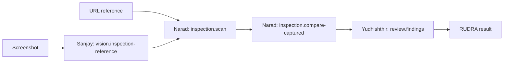

# Phase 07 — Vision and UI inspection

Implemented 2026-10-27 (Asia/Calcutta). ShivAX remains dependency-free and keeps
its existing neural, tensor, MNIST, visual and package APIs. New integration
code composes the existing specialist and security layers; it does not replace
Inspectra's browser engine or ShivAX's visual matcher.

## Verified Inspectra API

Inspected the sibling repository's `package.json`, `node/index.mjs`,
`node/index.d.mts`, `scanner/browser-snapshot.js`, `ui-check.js` and extraction
tests. Actual package: `inspectra-engine` **1.0.1**. Published Node exports include
`captureUISnapshot`, `captureUIPage`, `captureUISnapshotPair`, `compare`,
`capturePNGBaseline` and Figma capture functions. ShivAX does not assume APIs from
the historical `inspectra-automation` name.

The separately versioned [adapter package](../adapters/inspectra/README.md) uses
`captureUIPage(page, options)` and the actual `{snapshot, metadata, screenshot?}`
result. The host supplies a restricted, isolated page lease and optional artifact
destination. This keeps browser creation, navigation policy, authentication and
filesystem access at the host boundary. No sibling repository is modified.

## Contracts and workflow

`InspectionProvider.capture({url, viewport}, context)` returns unknown for runtime
validation. Context supplies the verified principal, session and abort signal.
`InspectionObservation` is an immutable, bounded envelope with:

- The existing normalized `UISnapshot`: bounds, computed typography, padding,
  margins, gaps, semantic roles and captured DOM relationships.
- Node sidecars: structural DOM path, positional selector, tag and visibility.
- Screenshot dimensions/MIME/opaque artifact reference when actually captured;
  otherwise explicit `unavailable`.
- Provider attribution and `trust: 'untrusted'`.

Observations are capped at 64 nodes plus the existing finite-JSON byte/node/depth
limits. Large pages must be narrowed by the host; truncation is not silently
reported as a complete scan. Scope, complete sidecars, viewport, measurements,
unknown fields and executable values are validated. All data remains untrusted,
including a successfully reviewed result.

`InspectionPlanner` selects a fixed ordered plan:



URL-to-URL captures two pages; supplied reference-to-URL captures only the target.
The existing matcher uses roles/content and structural context, resolves
correspondence, then the existing analyzer compares measured visual properties.
Geometry is supporting evidence, not a replacement for semantic matching.
Ambiguous matches remain diagnostic; viewport mismatch suppresses incomparable
geometry. This is deterministic property/geometry comparison, not pixel-image
similarity scoring.

Yudhishthir recomputes the analysis from the supplied pair and rejects any
altered analysis before emitting findings. Each finding includes issue type,
reference/target element identity and selector, expected/actual values, evidence,
severity and a suggested correction. Existing confidence, provenance and
`needs-review` status remain intact. `validated: true` means deterministic
consistency; it does not certify the truth of a model observation or authorize
an automatic correction.

## Host composition

```ts
const system = createSpecialistSystem({
  inspection: {
    provider, // e.g. separately installed InspectraInspectionProvider
    options: {
      authorizeURL: (url, identity) => hostURLPolicy(url, identity),
      // Omit to deny all supplied screenshot/design references.
      authorizeReference: (observation, identity) => hostReferencePolicy(observation, identity),
    },
  },
  vision, // optional VisionModelAdapter
  hooks: { planner: new InspectionPlanner() },
  security: { jay, policies, options: { approve } },
});
const task = await jay.createContext({ id: 'ui-check', input: {
  capability: 'inspection.scan',
  data: { reference: { kind: 'url', url: 'https://approved.example/reference' },
    target: 'https://approved.example/target', viewport: { width: 800, height: 600 } },
} }, { signal, toolPermissions: ['shivax.inspection.capture'],
  limits: { maxInputBytes: 1_048_576, maxOutputBytes: 1_048_576, timeoutMs: 30000 } });
const result = await system.rudra.run(task, {
  allowedCapabilities: INSPECTION_WORKFLOW_CAPABILITIES, maxSteps: 4,
});
if (result.status === 'completed') {
  const reviewedFindings = result.outputs.at(-1)?.data;
}
```

The example's policies, identity, approval, URL/reference admission and provider
are host-owned functions; they are not built-in grants. Register capability
policies for the selected workflow and a tool policy for
`shivax.inspection.capture`. Classify `inspection.scan` and its tool as
**state-changing**, requiring explicit approval, since page navigation runs page
code and configured capture may write artifacts. Policies deny by default and
Vijay rechecks them at tool execution. The additional URL admission checks all
requested URLs before either scan begins. Only HTTP(S) without embedded
credentials or fragments is accepted. Redirect/subresource policy must also be
enforced by the host's browser lease.

The planner never grants its own allowlist. Calls share RUDRA's total timeout,
step limit, cancellation and result budget. URL workflows need three steps;
screenshot workflows need four. RUDRA retains intermediate outputs and counts
their aggregate bytes; callers must provision sufficient bounded budgets.
Pending provider calls retain workflow ownership after timeout until settled.
Protected tool contexts expose an optional readonly `checkExecution` checkpoint;
the capture service and adapter use it before starting another side effect so a
blocking host policy/module loader cannot start capture after the deadline.
No partial result is labelled validated after a failed scan or failed review.

## Screenshot and future design references

The new `vision.inspection-reference` capability accepts
`{image: {mimeType, base64}, target, viewport}`. The declared viewport defines the
CSS-pixel coordinate space of the screenshot. Sanjay calls the configured vision
adapter with the image and coordinate instructions and validates labels,
confidence and in-frame bounds. Empty or malformed interpretations fail. Returned
nodes are estimates; unknown confidence yields unknown bounds. No font family,
CSS padding/margins, semantic role or DOM selector is invented from pixels.
Screenshot bytes are not retained in the resulting reference or trace.

Flat screenshot observations use an explicit cross-modal comparison path shared
by Narad and Yudhishthir. Captured DOM ancestry removes aggregate ancestor text
from candidate selection. Unique exact visible-text labels (normalized for case,
Unicode and whitespace) establish correspondence across the flat screenshot and
nested DOM. Only then does the existing analyzer compare the matched bounds in
their declared coordinate frames. Each pair is compared independently, without
inventing DOM roles, parentage or sibling gaps. URL-to-URL and structured design
references continue through the existing hierarchical matcher.

Duplicate, blank, changed or absent labels remain unresolved diagnostics;
coincident geometry never establishes identity. Screenshot interpretations are
partial evidence, so unmatched DOM nodes and observations do not establish
definite extra or missing elements. Unlabelled images, OCR paraphrases and text
aggregates require a richer future adapter. Review validates consistency, not
complete screenshot coverage or model accuracy. Unknown-confidence bounds retain
unknown provenance; different viewport sizes suppress geometric comparison.

`createInspectionVisionAdapter(id, router, routingOptions)` connects Sanjay to a
host-registered `visual-interpretation` ModelProvider with a structured output
contract. It does not install a model. The Phase 05 Ollama text adapter does not
claim image support; use a genuinely image-capable host provider. Missing vision
support fails explicitly. No live model quality is claimed by this phase: tests
use labelled contract fixtures, while browser captures are real.

For Figma-derived references, a future separately authenticated adapter can
return an `InspectionObservation` with `snapshot.sourceType: 'figma'`, explicit
design units/provenance and the verified scope. Pass it as
`reference: {kind: 'observation', observation}` after host authorization. This
phase never fetches Figma links, reads tokens or configures Figma authentication.

## Files, verification and limitations

New source: `src/inspection/{types,contracts,validation,services,operations,planner,vision,index}.ts`.
Modified: `src/index.ts`, `src/bots/{sanjay,narad,yudhishthir,system}.ts`, and
`src/security/{types,tools}.ts` for the additive host deadline checkpoint.
Separate adapter: `adapters/inspectra/{package.json,index.mjs,index.d.mts,README.md,refresh-fixtures.mjs,test-live.mjs}`.
Tests: `tests/inspection.test.mjs`, `tests/fixtures/{inspection-system.mjs,inspectra-loader.mjs,inspection-page.html,inspectra-captures.json}`;
updated portable declarations in `tests/package.test.mjs` and capability count
(24 → 28) in `tests/specialists.test.mjs`. Updated architecture/phases documents.

Verification: **349 tests passed, zero failures/cancellations/skips**, including
all 323 previous tests and 26 new offline tests using six actual Inspectra/Chromium
captures, plus an optional live test through the real `captureUIPage` API and
protected RUDRA workflow. Typography, missing elements, nested structure, spacing,
alignment, responsive viewports, invalid observations, failed scans, permission
denial, screenshot routing, tampering, cancellation and timeouts are covered.
The normal tests do not need Inspectra or a browser runtime installed. Clean
TypeScript/Rollup build, type check, existing lint and ES2020-only public type
consumers (including the separate adapter declarations) pass. Package dry run
contains 96 entries, including eight new inspection declaration files; the
separate adapter and browser runtime are not bundled. Root exports now include
92 runtime and 185 type-only names,
preserving every original export. Existing nonfatal Rollup helper warnings remain.

Visibility means included by Inspectra's rendered-document filter, not necessarily
inside the viewport; hidden/clipped nodes are not inventoried. Screenshots are
optional host artifacts. Positional selectors can become stale. No cross-browser
matrix, real vision-model evaluation or pixel similarity metric is claimed.
Figma authentication and Visynq application wiring remain future work.

Phase 05's two budget-review findings remain unresolved. Phase 06's delete/recreate
concurrency and tiny-vector cosine findings were resolved in the subsequent
[memory review fixes](memory-engine.md#review-fixes--2026-10-27). Default URL
inspection requires neither memory nor model inference.

Phase 07 implementation complete; stop before Phase 08.

## Review fixes — 2026-10-27

Resolved the screenshot correspondence and premature cancellation cleanup findings.
Added `src/inspection/comparison.ts`, used by comparison and review; corrected
unknown bounds in `src/inspection/vision.ts`. The separate Inspectra adapter now
caches one cleanup promise for abort and finalization. Cancellation can return
from RUDRA promptly, while it retains ownership until the underlying cleanup
settles. Adapter declarations and documentation describe the cleanup contract.

Regression tests assert actual screenshot-to-DOM correspondence, bound changes,
tamper rejection, ambiguity, partial coverage, unknown confidence and viewport
mismatch. Cleanup tests cover delayed resolution/rejection, cancellation during
page acquisition and retained RUDRA ownership. The earlier 349-test result above
records the original implementation; updated verification is recorded below.

Verification: **360 tests passed, zero failures/cancellations/skips** (11 added
regressions; 37 inspection tests). Clean TypeScript/Rollup build, type checks,
portable ESM/CJS declarations and lint pass. The live Inspectra URL workflow
passes with both isolated leases closed. Package dry run contains 97 entries;
no package was published. Original ML/visual source, browser digit demo and dataset
are unchanged. Existing nonfatal Rollup helper and Inspectra module-type warnings
remain. The two Phase 07 review findings are resolved; no later phase was started.
