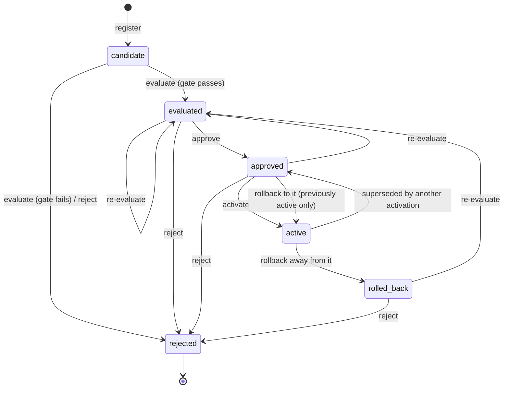

# Durable model registry (SARASWATI S04)

`shivax/learning` (and the root `shivax` entry) adds a durable lifecycle for model
and configuration versions. A version moves through these steps:

1. **registered:** the version is stored;
2. **evaluated:** it is checked against S02 benchmark evidence;
3. **approved:** a trusted administrator approves it;
4. **activated:** it becomes active through one compare-and-swap;
5. **rolled back:** if needed, a verified earlier version is restored.

Source:

- `src/learning/registry.ts` (lifecycle);
- `src/learning/registry-store.ts` (storage contract, `InMemoryModelRegistryStore`,
  `ModelRegistryError`, `sha256Text`).

Tests are in `tests/learning-registry.test.mjs`. Example:
`examples/sdk/model-registry.mjs`.

The in-memory `EvaluatedModelUpdates` from 0.2.0 is unchanged and still works on
its own.

## Lifecycle



- Only `approved` can become `active`. There is no path from `candidate` or
  `evaluated` to `active`.
- `rejected` is terminal. Register a new version instead.
- When a new version is activated, the previous one becomes `approved` again and
  goes onto the rollback stack (64 entries at most).
- Rollback activates the most recent eligible entry, or a named one, and marks
  the current version `rolled_back`. A rolled-back version needs new evidence and
  a new approval before it can return.
- Nothing is activated automatically. Registration, evaluation and approval
  never change the active version (test R18).

## Storage adapter contract

ShivAX owns no database, directory, cloud bucket or global state. The host
supplies one `ModelRegistryStore` per registry, meaning one tenant and one
deployment slot, chosen by trusted configuration:

```ts
interface ModelRegistryStore {
  putObject(key: string, text: string, signal): Promise<void>;          // immutable, content-addressed
  getObject(key: string, signal): Promise<string | null>;                // exact text, or null
  readHead(signal): Promise<string | null>;                              // exact head text, or null
  compareAndSwapHead(expectedRevision, nextText, nextRevision, check, signal): Promise<boolean>;
}
```

**Objects**

- The key is `sha256:<hex>` of the exact text.
- `putObject` must be idempotent and must never leave a partial object under a
  key. Write to a temporary name, then rename or commit.

**Head swap**

- `compareAndSwapHead` must be atomic for every process that can write this
  registry, through a database transaction, a conditional write or a fenced lock.
- It compares against the revision of the stored head (0 when there is none).
- It calls `check()` immediately before the durable write and abandons the write
  if `check()` throws.
- It returns `false` on a revision conflict and throws on failure or an unknown
  outcome.

**Other requirements**

- Honour `signal` for reads and object writes.
- Never log stored text: it contains weights and approval metadata.

**Reference stores**

- `InMemoryModelRegistryStore`: isolated per instance; for tests, examples and
  hosts that accept losing state on exit.
- `TempFileRegistryStore`: test-only, in `tests/fixtures/model-registry.mjs`. It
  shows a file layout (`objects/<hex>.json` plus `head.json`, written through a
  temporary file and rename), but its compare-and-swap is safe only within one
  process.

## Records

All records are canonical JSON (sorted keys) with closed schemas, validated
whenever they are read.

| Record | Content |
| --- | --- |
| `shivax-model-artifact` v1 | `model` (a `shivax-neural-net` v1, normalized through `NeuralNet.fromJSON(...).toJSON()` with weights copied exactly, or `null` for configuration-only versions) and `configuration` (up to 64 KiB) |
| `shivax-model-manifest` v1 | The items below this table |
| `shivax-model-evaluation` v1 | Stored suite and both reports (object keys and S02 digests); evaluator; policy id and security-profile digest; `eligible` and gate reason codes; mandatory and security counts; leakage check and training digests; time; actor |
| `shivax-model-approval` v1 | Version, manifest and evaluation keys; approver; `approvedAt` and `expiresAt`; the active manifest at approval; the firewall policy version and mode; the security profile; a nonce |
| `shivax-model-journal` v1 | Sequence, revision, time, operation id, action, version, from and to states, displaced version, active version after the change, actor, reason codes, and `prev` (the previous entry's key) |
| Head `shivax-model-registry` v1 | Registry id, owner, issuer, revision, `nextSequence`, security profile, version table (state plus the keys of manifest, evaluation and approval), active version, rollback stack, journal tip and length, last operation id, `checksum`, and an optional `signature` |

A `shivax-model-manifest` v1 holds:

- the model id and version id;
- the registration sequence;
- the owner (tenant scope);
- the artifact checksum, size, format and architecture;
- the S01 dataset id, version and digest, plus the stored manifest object;
- the training method, options and seed, and the parent version;
- the creation time and creator;
- (approval and activation status are in the head and the approval records).

Actor references are opaque host tokens (16–128 characters of `[A-Za-z0-9_-]`).
Names, emails and session ids are never stored.

**Integrity and authenticity**

- Checksums show that content has not changed. They are SHA-256, not
  signatures: anyone with write access to the store can write consistent content
  with matching checksums.
- For authenticity, configure `signer`, for example an HMAC or Ed25519 key in the
  host's key management. The head checksum is then signed and verified on every
  read. Because the head names every object by digest, a signed head
  authenticates the whole registry.
- Without a signer, the authenticity controls are the host's approval journal
  (`approvals.record` / `approvals.confirm`) and the store's access control.

## Transaction design

Every change is a single head compare-and-swap, made after its immutable
objects are written:

1. Take this instance's operation lock (at most 32 waiters, after which
   `busy`). Wait for any earlier swap whose outcome is still unknown.
2. Reload and validate the head, including its checksum, signature, tenant,
   journal tip and active manifest.
3. Authorize the administrator:
   - `jay.verify`, then check the issuer and the tenant scope;
   - call `authorize`, which must return an opaque actor reference;
   - call `jay.assertActive` and the `checkAuthorization` fence.
   This happens before anything else is revealed.
4. Check `expectedRevision` against the stored head (otherwise `conflict`).
5. Check the transition and its evidence, write the immutable objects, and
   verify each by reading it back. A torn write is detected by checksum and
   rewritten once.
6. Write the journal entry (`prev` = the current tip). Build, checksum and
   optionally sign the next head (revision + 1, a new random operation id).
7. Run the guard: not closed, not cancelled, session active,
   `checkAuthorization` still true, and, for approve, activate and rollback, the
   firewall still open with an unchanged policy version.
8. Call `compareAndSwapHead(revision, next, revision + 1, guard)`. The store runs
   the guard again immediately before its durable write.

**Outcomes**

| Store result | Registry decision |
| --- | --- |
| `true` | Committed |
| `false` | `conflict`. Another writer won; nothing of ours is visible |
| Throws | Read the head. If `lastOperation.id` is ours, it committed and the call succeeds. Otherwise it did not commit and the guard's error or `storage-unavailable` is reported |
| Cancelled or timed out mid-swap | `outcome: 'unknown'`. The next operation waits for the swap to settle and reads the head |

**Why this prevents conflicts**

- **Monotonic versioning:** the head revision increases by 1 on every change, and
  registration sequence numbers are assigned from `nextSequence`.
- **Conflict detection:** both `expectedRevision` and the compare-and-swap
  revision are checked.
- **Immutable snapshots:** content-addressed objects are never overwritten.
- **Competing activations:** two requests for the same revision cannot both
  commit. The loser gets `conflict` (R10, in one process and across two
  instances). Its approval is then also stale, because the active version
  changed.

## Approval and activation rules

**`evaluate`:**

- The S02 suite must belong to the registry's tenant.
- Both reports must pass `validateBenchmarkReport` against the suite.
- The candidate report must be bound to this exact version. Its configuration is
  `registry.benchmarkConfiguration(versionId, 'candidate')`, a digest of
  `{ registryId, modelId, versionId, manifest }`.
- The baseline report must be bound to the version that is active now. Any
  baseline is accepted only while nothing is active.
- If the version names an S01 dataset, its training split export must be
  supplied (its digest must match the dataset manifest). The leakage check then
  runs on the real training data.
- `assessBenchmarkCandidate` runs with the registry's trusted evaluators and
  policy (default `STRICT_BENCHMARK_POLICY`).
- **Evidence problems → `evidence-rejected`, nothing recorded:** untrusted
  evaluator, model judge, leakage, unevaluated cases, a domain that was not
  evaluated, missing mandatory security cases (`requireSecurityCases`, default
  true), invalid reports, or wrong bindings.
- **Quality failures → `rejected`:** mandatory or security failures, regression,
  thresholds.

**`approve`** (state `evaluated`):

- The firewall must not be in lockdown and must be admitting operations.
- The evidence must be younger than `evidenceTtlMs` (default 7 days) and recorded
  under the current security profile.
- The baseline must still be the active version.
- The stored suite and reports are re-verified and the gate is run again.
- The artifact's checksum and compatibility are verified (format, architecture,
  optional `checkCompatibility`).
- With `separationOfDuties`, the approver must differ from the registrant and the
  evaluator.
- `approvals.record` must return literal `true` before the commit.

**`activate`** (state `approved`):

- The approval must match this version and evaluation.
- It must not be expired (`approvalTtlMs`, default 24 h).
- The active version must be the one recorded at approval.
- The firewall policy version and the security profile must be unchanged since
  approval.
- `approvals.confirm` must return literal `true`. This rejects a forged approval
  object swapped into storage (R9).
- With `separationOfDuties`, the activator must differ from the approver.
- The firewall must be open and not in lockdown, both before preparation and
  inside the commit guard.
- The artifact is verified again.

**`rollback`:**

- The target must be a previously active version in the `approved` state.
- Its manifest and artifact must verify, and `approvals.confirm` must still
  confirm its approval (a revoked approval blocks rollback).
- A fresh administrator authorization is required.
- Firewall lockdown blocks rollback unless `allowRollbackDuringLockdown` is set.
- Rollback never changes the tenant, the journal (it only appends), the
  firewall, the registry's security settings or the approval rules.

The **security profile** is a digest of the settings that decide promotion:

- the policy;
- the trusted evaluators;
- `requireSecurityCases`, `separationOfDuties`, `allowRollbackDuringLockdown`;
- the time-to-live settings;
- the supported formats.

Evaluations and approvals record it. Changing it, for example restarting the
host with a weaker policy, makes them stale rather than silently applying the
old rules.

## Recovery policy (deterministic)

| Condition | Behaviour |
| --- | --- |
| Head missing | `openModelRegistry` → `registry-missing`. Never recreated or defaulted. `createModelRegistry` refuses a store that already has a head (`registry-exists`) |
| Head unparsable, schema invalid, checksum wrong or signature invalid | `corrupt-registry`. Fails closed, nothing is written; restore from backup |
| Head of another tenant, issuer or registry id | `cross-tenant` |
| Journal tip missing or invalid | `health.journal = 'unavailable'`. Reads work; every change is refused until the journal is restored, because audit history must stay continuous |
| Active manifest missing or corrupt | `health.active = 'unavailable'`. `loadActive` fails with `object-missing` or `checksum-mismatch` and never falls back to another version silently. An authorized rollback to a verified previous version repairs it (R8) |
| Any object missing or failing its checksum | That operation fails with `object-missing` or `checksum-mismatch`. `verify()` lists every affected version and object |
| Interrupted object write | Detected by read-back checksum and rewritten once; unreferenced objects are ignored |
| Interrupted or ambiguous head swap | Resolved by reading the head and its operation id (see Transaction design) |
| Host restart | `openModelRegistry` rebuilds everything from the head; `loadActive` returns the verified active version |
| Partial activation | The head swap *is* the activation. If the host fails to apply it to its runtime, it re-applies on restart from `loadActive`. Registry state is never half-activated |
| Concurrent writers | Compare-and-swap; the loser gets `conflict` and must refresh |

## Security controls

- **Administrator identity and tenant.**
  - Identity comes only from a Jay-minted, live context, never from request data.
  - The issuer and the tenant scope must match the registry. Copied contexts,
    revoked sessions, a role revoked between authorization and commit, and
    non-opaque actor references are all refused (R14).
- **Tenant isolation.** The tenant is enforced at:
  - the administrator;
  - the dataset (S01 owner);
  - the suite (S02 owner);
  - the stored head and manifests.
- **Firewall.** NARASIMHA is read through `status()`, with lockdown and closed
  admission checked before and inside the commit. A firewall policy change
  invalidates approvals. Test R12 uses a real NARASIMHA firewall.
- **No authority from data.** Payloads cannot mark themselves evaluated or
  approved: the registry derives every state from evidence it verifies and from
  host hooks that must return literal `true`.
- **Opaque errors.** Messages never contain storage errors, paths, actor
  references or model data.
- **Host-only object.** The registry object is a host controller. Never expose
  it, or its store, to bots, tools or browser code.

## Migration

- Nothing migrates automatically. `EvaluatedModelUpdates` and the in-memory
  rollback from 0.2.0 are unchanged.
- To adopt the registry:
  1. call `createModelRegistry` once;
  2. register the model that currently runs (its `shivax-neural-net` v1 JSON is
     accepted as is, with weights unchanged);
  3. evaluate it against your suite, approve it and activate it.
- There is deliberately no import that marks an existing model `active` without
  evidence and approval.
- S01 dataset manifests and S02 suites and reports are used as they are.
  S03 worker training produces the same model JSON, so candidates trained in
  workers register the same way.

## Limits

| Item | Limit |
| --- | --- |
| Versions per registry | 512 by default, at most 1,024 (`maxVersions`). The maximum keeps the head under its 1 MiB read limit even with 256-character ids; a commit whose head would exceed it is refused with `capacity` |
| Artifact | 32 MiB of canonical JSON characters by default, at most 64 MiB |
| Configuration | 64 KiB |
| Training options | 8 KiB |
| Other records | 1 MiB each |
| Rollback stack | 64 |
| Audit page | 1,000 entries (`verify()` walks the whole chain) |
| Operation timeout | 30 s by default, at most 600 s |
| Waiting operations per instance | 32 |
